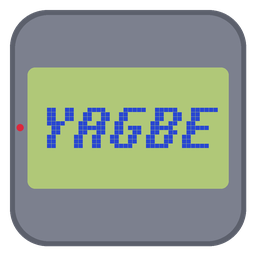

<h1 align="center">YAGBE – Yet Another Game-Boy Emulator</h1>

Kostenloser Game-Boy-Emulator für Windows, Linux und macOS. 
<b><a href="https://malte007.github.io/YAGBE/">Zur Webseite</a></b> · <a href="https://github.com/Malte007/YAGBE/releases/latest">Neueste Version</a>

## Download

| System | Datei |
|---|---|
| Windows 10/11 (64 Bit) | [YAGBE-win-x64.zip](https://github.com/Malte007/YAGBE/releases/latest/download/YAGBE-win-x64.zip) |
| Linux (64 Bit) | [YAGBE-linux-x64.zip](https://github.com/Malte007/YAGBE/releases/latest/download/YAGBE-linux-x64.zip) |
| macOS mit Apple-Chip (M1, M2 …) | [YAGBE-osx-arm64.zip](https://github.com/Malte007/YAGBE/releases/latest/download/YAGBE-osx-arm64.zip) |
| macOS mit Intel-Prozessor | [YAGBE-osx-x64.zip](https://github.com/Malte007/YAGBE/releases/latest/download/YAGBE-osx-x64.zip) |

ZIP entpacken und `YAGBE` starten, installiert werden muss nichts. Hilfe zum ersten Start
(Windows SmartScreen, macOS Gatekeeper) steht auf der [Webseite](https://malte007.github.io/YAGBE/#hilfe).

Spiele (ROMs) sind nicht enthalten.

## Was liegt hier?

Dieses Repository enthält nur die Webseite (GitHub Pages) und die fertigen Downloads.
Der Quellcode liegt in einem privaten Repository; neue Versionen landen automatisch hier unter **Releases**.

YAGBE ist ein privates Hobbyprojekt ohne Verbindung zu Nintendo. „Game Boy“ ist eine Marke von Nintendo.
Die Pixelschrift der Webseite ist *Press Start 2P* unter der [SIL Open Font License 1.1](assets/fonts/OFL.txt).
